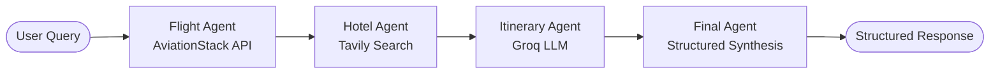

# ✈️ TripMate AI - Multi-Agent Travel Planner

**TripMate AI** is an intelligent travel planning assistant built with **LangGraph**, **FastAPI**, **Groq LLMs**, and PostgreSQL for conversational state persistence.

The application coordinates multiple specialized AI agents into a structured workflow to retrieve real-time flight data, discover top-rated hotels, craft realistic day-by-day itineraries, and synthesize everything into a clean travel recommendation.

---

## 🏗️ Architecture & Agent Flow

The workflow is modeled as a stateful graph using **LangGraph**:



1. **Flight Agent**: Interacts with the AviationStack live flight API to query flight schedules and route availability.
2. **Hotel Agent**: Utilizes Tavily Search to discover popular, budget-friendly, and top-reviewed hotels for the requested destination.
3. **Itinerary Agent**: Crafts a detailed, day-by-day practical travel itinerary accounting for flights and hotel locations.
4. **Final Agent**: Synthesizes all gathered information into an easy-to-read, beautifully formatted travel plan (Trip Summary, Flights, Hotels, Itinerary, Budget, and Tips).
5. **PostgreSQL Checkpointer**: Persists conversation history using `PostgresSaver` across distinct `thread_id` sessions.

---

## 🚀 Features

- **Multi-Agent Orchestration**: Independent agents responsible for dedicated tasks (flights, hotels, itinerary creation).
- **Session Memory**: Backed by PostgreSQL (`psycopg` + LangGraph `PostgresSaver`) for multi-turn conversational checkpointing.
- **Fast Inference**: Powered by Groq for high-speed LLM generation.
- **RESTful API**: Built with FastAPI, including health checks, JSON API endpoints, and interactive Swagger docs.
- **Tool Integration**: Tavily Search API and AviationStack Flight API.

---

## 📁 Project Structure

```text
├── app.py                  # FastAPI web server and API endpoints
├── backend.py              # LangGraph workflow, agent nodes, and Postgres checkpointer
├── templates/              # Jinja2 HTML templates
│   └── index.html          # Web UI interface
├── tools/                  # Tool integrations
│   ├── flight_tool.py      # AviationStack flight search tool
│   ├── tavily_tool.py      # Tavily search tool for hotel information
│   └── test/               # Test scripts for backend and tools
│       ├── Backend_test.py
│       ├── flight_test.py
│       └── tavily_test.py
├── pyproject.toml          # Project configuration and dependencies (uv)
└── .env                    # Environment variables and API keys
```

---

## ⚙️ Environment Variables

Create a `.env` file in the root directory with the following keys:

```ini
# LLM Provider
GROQ_API_KEY=your_groq_api_key

# Database Checkpointer (PostgreSQL with SSL)
DATA_BASE_URL=postgresql://<user>:<password>@<host>/<dbname>?sslmode=require

# External Tools & APIs
AVIATIONSTACK_API_KEY=your_aviationstack_api_key
TRAVILY_API_KEY=your_tavily_api_key

# LangSmith Tracing (Optional)
LANGSMITH_TRACING=true
LANGSMITH_ENDPOINT=https://api.smith.langchain.com
LANGSMITH_API_KEY=your_langsmith_api_key
LANGSMITH_PROJECT=MultiAgent
```

---

## 🛠️ Getting Started

### 1. Installation

Using [`uv`](https://docs.astral.sh/uv/) (recommended):

```powershell
uv sync
```

Or using standard `pip`:

```powershell
pip install -r requirements.txt
```

### 2. Run the FastAPI Server

```powershell
uv run python app.py
```

The application will start at:
- **Web App / Root**: [http://127.0.0.1:8000/](http://127.0.0.1:8000/)
- **Interactive Swagger Docs**: [http://127.0.0.1:8000/docs](http://127.0.0.1:8000/docs)
- **Health Check**: [http://127.0.0.1:8000/health](http://127.0.0.1:8000/health)

---

## 📡 API Reference

### `POST /api/travel`

Generates a comprehensive travel plan for the given request.

**Request Body:**
```json
{
  "message": "Plan a 3-day trip to Goa from Delhi for 2 people with a budget focus",
  "thread_id": "optional_user_session_id"
}
```

**Response Body:**
```json
{
  "success": true,
  "thread_id": "optional_user_session_id",
  "answer": "## 1️⃣ Trip Summary\n...",
  "flight_results": "...",
  "hotel_results": "...",
  "itinerary": "...",
  "llm_calls": 4
}
```

---

## 🧪 Testing

Run tool and agent tests directly via the test scripts:

```powershell
# Test the complete backend multi-agent pipeline
uv run python tools/test/Backend_test.py

# Test Tavily hotel search tool
uv run python tools/test/tavily_test.py

# Test flight search tool
uv run python tools/test/flight_test.py
```

